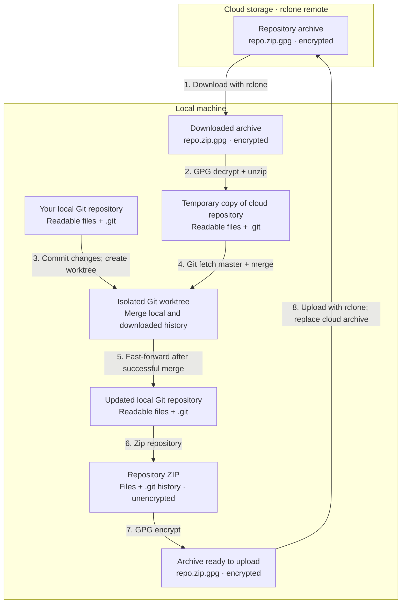

# devops

`devops` is the main operational CLI for package installation, repo automation, config sync, data sync, self-management, networking, script execution, and vault access.

---

## Usage

```bash
devops [OPTIONS] COMMAND [ARGS]...
```

## Current top-level commands

| Command | Purpose |
| --- | --- |
| `software` | Install software and manage installer catalogs |
| `repos` | Manage development repositories |
| `config` | Configuration and dotfile workflows |
| `data` | Backup and restore configured data paths; encrypt or decrypt local files and folders |
| `self` | StackOps self-management and developer workflows |
| `network` | Sharing, transfer, address, SSH, and device helpers |
| `scripts` | Run, list, locate, and edit scripts |
| `vault` | Search and load secrets, manage entries, and access Bitwarden |
| `security` | Run security and installer-audit helpers |

---

## `software install`

```bash
devops software install [OPTIONS] [WHICH]
```

Current options:

- `--group` to treat `WHICH` as a bundle name
- `--source` to select `library`, `user`, or `all` installer catalogs; defaults to `all`
- `--custom-path` to replace the user catalog with another file; `--source all` still merges it with the library catalog
- `--check` to report binary availability without installing or validating catalog entries
- `--interactive` to choose packages interactively
- `--explore` / `-x` to browse installer `categoryLabels` before choosing packages
- `--update` to reinstall or upgrade when supported
- `--version` to request a specific version or tag

Example:

```bash
devops software install --group sysabc
devops software install --explore
devops software install ai-agents-assistants -x
devops software install lazygit,fd --update
```

Use `software list` to browse definitions, `path` to locate catalogs, `init` to create an empty user catalog, `edit` to modify it, and `validate` to check it.

These software commands all accept `--custom-path` for the user catalog. `list`, `install`, and `path` support `--source library`, `user`, or `all`; a custom path works with `user` or `all`, but not `library`. `init`, `edit`, and `validate` accept only `--source user`, which is also their default.

User catalog entries may reference `.sh`, `.ps1`, or `.py` installer scripts by file name; place them in an `installer_scripts/` directory next to the catalog (`~/dotfiles/stackops/config/installer_scripts/` by default). `software path` prints both script directories, and `software validate` fails if a referenced script is missing or its name is not unique across the user and library script directories.

---

## Current command groups

These are the child commands exposed by the current live help.

`repos`:

- `sync`
- `register`
- `list`
- `edit`
- `path`
- `init`
- `validate`
- `action`
- `version`
- `guard`
- `stats`

`repos stats`:

- `visualize`
- `count-lines`
- `analyze`

`config`:

- `interactive`
- `dotfiles`
- `edit`
- `path`
- `init`
- `validate`
- `copy-assets`
- `export-example`
- `init-script`
- `terminal`
- `setup`

`config dotfiles` provides `sync`, `register`, `export`, `import`, `path`, `init`, and `validate`. The last three locate, initialize, or validate the managed mapping. They are also available as `config path/init/validate dotfiles`; `config export-example dotfiles` exports its example and schema. Secrets are managed under `vault`.

`config dotfiles register` and `data register` accept only `--source user`, which is also the default. `--source` uses `-s`. Dotfile registration stores files under the user `mapper/files` directory by default; `--destination` selects an explicit storage directory.

`config dotfiles sync --source` / `-s` selects `user`, `library`, or `all` mappings. `library` contains only bundled settings mappings backed by `~/.config/stackops/settings`; `user` uses your mapper, and `all` combines both with user groups taking precedence. Personal credential mappings are available in the exported user example. Sync processes all entries selected by that source and `--which`.

Generic `config` management commands and the dotfile/data `path`, `init`, and `validate` commands use `--custom-path` to select an explicit file. Standalone `repos` management commands retain `--path`.

`data`:

- `sync`
- `register`
- `list`
- `subset`
- `encrypt`
- `decrypt`
- `path`
- `init`
- `validate`

Use `config edit data` to edit the backup mapping.

`self`:

- `install`
- `clone`
- `update`
- `status`
- `explore-cli`
- `explore-python-api`
- `readme`
- `docs`
- `build-installer`
- `download-installer`
- `release`
- `build-docker`
- `build-graph`
- `build-assets`

`network`:

- `share-terminal`
- `share-server`
- `send`
- `receive`
- `share-temp-file`
- `show-address`
- `vscode-share`
- `ssh`
- `cloudflare`
- `device`

`vault`:

- `search`
- `load`
- `stats`
- `subset`
- `add`
- `path`
- `init`
- `validate`
- `bitwarden`

`vault bitwarden`:

- `search`
- `login-and-unlock`
- `export-session`
- `sync`
- `clean-cache`

`security` lives directly under `devops`. `self` contains StackOps management commands and `status` for inspecting machine, repository, application, and configuration state; its developer commands require a local source checkout. `self build-assets` provides `cli-graph`, `charts`, and `skill-refs`.

---

## `repos guard`

`guard` syncs a Git repository through an encrypted archive in cloud storage. Your local working files and `.git` history stay readable; GPG encrypts the archive before upload and decrypts it locally after download. Git handles merging on your machine, while rclone transfers the encrypted archive.

```bash
devops repos guard ~/code/private-repo --cloud myremote --message "sync before travel"
```

When both the local repository and cloud archive exist, the flow is:



- **Encryption:** by default, GPG encrypts to your own key; restoring requires its private key. Supplying `--password` selects symmetric encryption with that password.
- **Archive contents:** repository files and `.git` history are encrypted together. Git-ignored files are excluded by default; `--ignore-gitignore` includes them.
- **First sync:** if the cloud archive is missing, guard commits local changes and publishes the first encrypted archive. If the local repository is missing, it downloads, decrypts, and restores the cloud copy.
- **Conflicts:** guard handles them in the isolated worktree using `--on-conflict` (default: `ask`). Stopping preserves that worktree and the downloaded copy for inspection; the live repository keeps its local commit without receiving merge conflict markers.

---

## `repos version`

Capture and restore named repository states in the workspace's `versions.json`:

| Command | Behavior |
| --- | --- |
| `declare VERSION --message TEXT` | Record repository commits, branches, remote information, and whether each working tree is dirty |
| `list` | List declared versions |
| `status VERSION` | Compare a declared version with the current repositories |
| `checkout VERSION` | Restore an existing repository collection to the declared commits and branches; `--dry-run` previews without fetching or changing repositories |

All four accept `--directory`, `-d` to select the workspace; the default is the current directory. `declare --recursive`, `-r` includes nested repositories. Checkout refuses dirty current repositories and versions captured with dirty repositories; it does not clone missing repositories.

```bash
devops repos version declare baseline --message "Before dependency updates" --directory ./workspace
devops repos version list --directory ./workspace
devops repos version status baseline --directory ./workspace
devops repos version checkout baseline --directory ./workspace --dry-run
```

---

## `data encrypt` and `data decrypt`

These local operations use GPG without uploading data or registering a backup entry. `encrypt PATH` accepts a file or folder; folders are archived first. `decrypt PATH` accepts a `.gpg` file and extracts a recognized folder archive after decryption. Both preserve the input and refuse an existing output path.

Both commands accept `--encryption`, `-e` (`symmetric`/`s` or `asymmetric`/`a`), `--password`, `-p`, and `--output`, `-o`. Symmetric encryption is the default and prompts for a password when omitted. For asymmetric encryption, `encrypt --recipient`, `-r` selects a GPG key; otherwise it uses the user's own key. Folder encryption supports `--compression`, `-c` with `zip` (default), `tar.gz`, `tar.bz2`, or `tar.xz`.

```bash
devops data encrypt ./notes.txt
devops data decrypt ./notes.txt.gpg --output ./restored-notes.txt
devops data encrypt ./project --encryption asymmetric --compression tar.gz
devops data decrypt ./project.tar.gz.gpg --encryption asymmetric --output ./restored-project
```

---

## `scripts`

```bash
devops scripts run [OPTIONS] NAME [SCRIPT_ARGS]...
```

Current behavior:

- `NAME` can be a predefined script name or a raw command string
- when `NAME` is a direct script file path, `run` executes it without searching the configured script roots. An explicit file overrides `--source`, including `--source dynamic`
- `--source`, `-s` selects search locations: `all/a`, `workspace/w`, `user/u`, `library/l`, or `dynamic/d`
- `--source workspace` or `-s w` searches `<workspace-root>/.stackops/scripts`. The root is the enclosing Git repository root, including from a subdirectory, or the current directory when it contains at least two immediate child Git repositories. Outside these locations, explicit `workspace` fails and `all` searches the remaining sources
- `--interactive` enables interactive selection
- `--command` runs the input as a command
- `scripts list` prints available scripts; `scripts path [NAME]` prints a resolved path or the search locations; `scripts edit NAME` opens a script from `workspace/w`, `user/u`, or `library/l`, or searches those locations with `all/a`
- `--subprocess`, `-S` runs shell scripts in a child Bash or PowerShell process instead of sourcing them in the caller
- put StackOps run options before `NAME`; arguments after it are forwarded to the script

Examples:

```bash
devops scripts list
devops scripts run -s library deploy
devops scripts run -s workspace deploy
devops scripts run -S deploy.sh
devops scripts run --command "echo hello"
devops scripts path deploy
devops scripts edit deploy --source user
```

---

## `vault`

```bash
devops vault COMMAND [ARGS]...
```

Current behavior:

- `search` selects StackOps secret bundles without loading environment variables; `--json` includes secret values
- `load` selects bundles and loads their environment variables; it uses the same terms and selectors as `search`
- `add` creates a new login entry; `stats` and `subset` inspect or export selected entries
- `path`, `init`, and `validate` manage the secrets file and schema
- `--source/-s` selects `workspace/w` or `user/u`; `search`, `load`, and `stats` also accept `all/a`
- The workspace secrets file is `<workspace-root>/.stackops/secrets/secrets.json`. The root is the enclosing Git repository root, including from a subdirectory, or the current directory when it contains at least two immediate child Git repositories. Outside these locations, explicit `workspace` fails and `all` includes only `user`; select `user` or pass a custom file
- `--custom-path/-p` selects exactly one secrets file and overrides `--source`, including `--source all`
- With no source or custom file, `search` and `load` prefer an existing workspace file and otherwise use the user file; `stats` reads all available sources
- `bitwarden search` retrieves Bitwarden credentials and can copy password, username, TOTP, or raw JSON to clipboard slots
- `bitwarden login-and-unlock` loads Bitwarden API credentials from StackOps secrets, unlocks the vault, and saves `BW_SESSION` locally
- `bitwarden export-session` prints an eval-able shell script that exports the saved `BW_SESSION`
- `bitwarden sync` synchronizes Bitwarden with the server and refreshes cached searches
- `bitwarden clean-cache` removes cached search results and any saved session token

Examples:

```bash
devops vault search github
devops vault load github --name github
devops vault load github --source user
devops vault search github --source all
devops vault search github --custom-path ./secrets.json
devops vault add --source workspace
devops vault validate --custom-path ./secrets.json
devops vault bitwarden login-and-unlock --account-name dev
devops vault bitwarden search github --copy password
devops v s github --json
eval "$(devops vault bitwarden export-session)"
devops vault bitwarden sync
devops vault bitwarden clean-cache
```

---

## Working with nested apps

The nested groups above are lazily loaded Typer apps. The exact leaf commands and flags live under those subtrees, so use help at the branch you care about:

```bash
devops repos --help
devops software --help
devops scripts --help
devops config --help
devops data --help
devops self --help
devops network --help
devops vault --help
devops vault bitwarden --help
devops self status --help
devops security --help
devops self docs --help
devops config terminal --help
```
